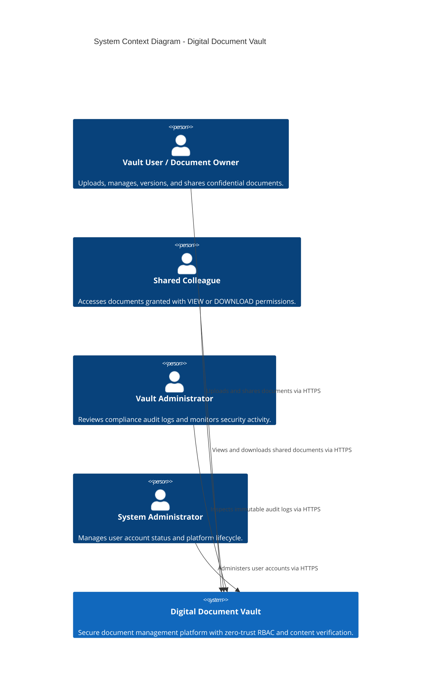
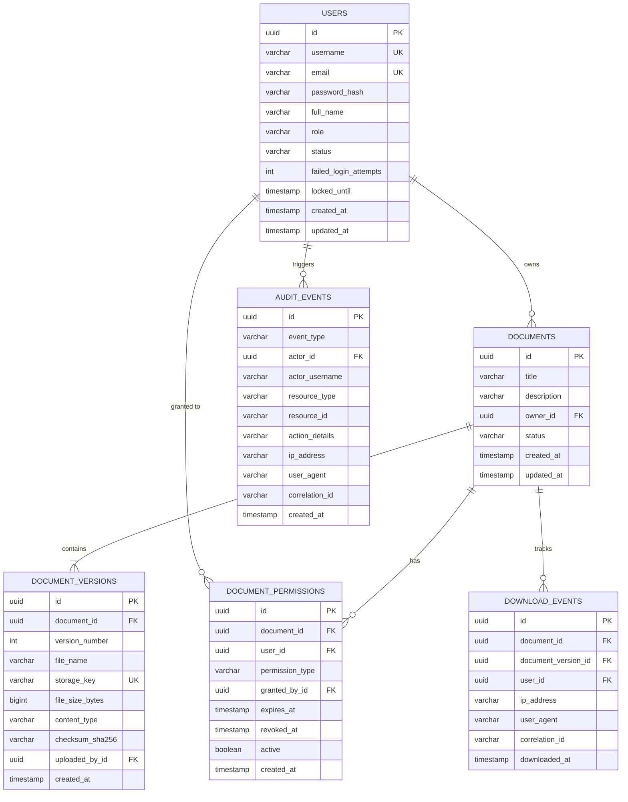
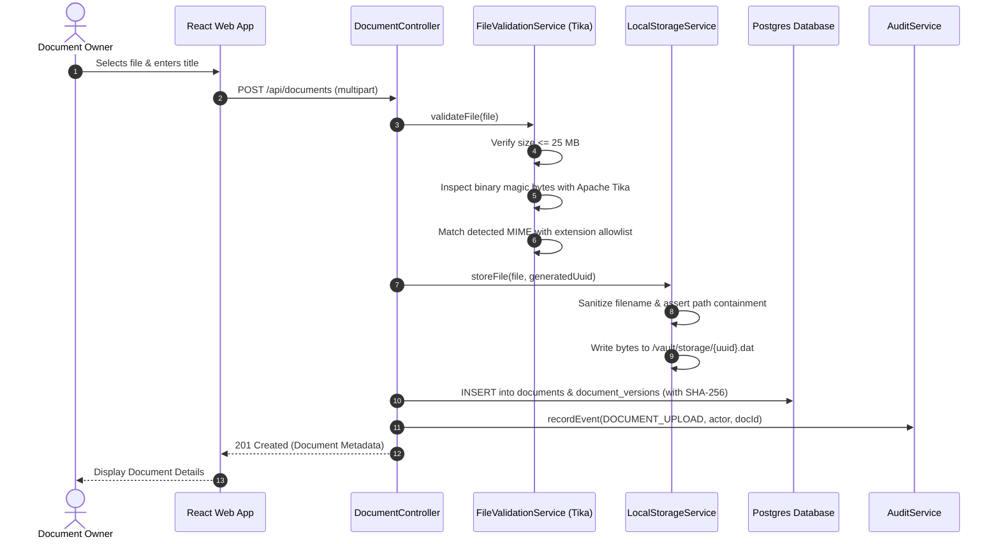
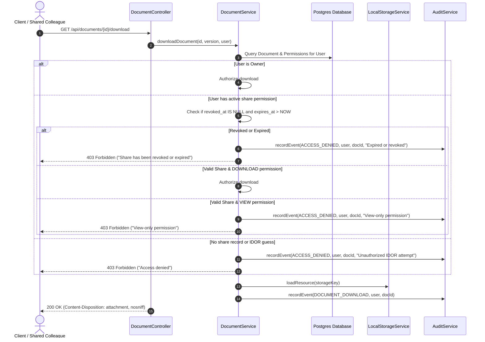

# Architecture Documentation: Digital Document Vault

This document details the high-level architecture, container interactions, data flow, trust boundaries, and Architectural Decision Records (ADRs) for the Digital Document Vault.

---

## 1. System Overview & C4 Context

The Digital Document Vault provides secure, tamper-evident document storage, granular sharing, and centralized auditing.



---

## 2. Container Architecture

```mermaid
graph TD
    subgraph Client Tier
        Browser["React 18 Single Page Application<br/>(TypeScript, Tailwind CSS)"]
    end

    subgraph Demilitarized Zone (DMZ)
        Nginx["Nginx 1.25 Reverse Proxy<br/>- TLS Termination<br/>- Static Content Cache<br/>- CSP & Security Headers"]
    end

    subgraph Application Tier
        SpringBoot["Spring Boot 3.3.4 Application Server<br/>- Spring Security (Session Auth, CSRF, Rate Limiting)<br/>- Document Service & Tika Magic Bytes Engine<br/>- Share & Revocation Policy Evaluator<br/>- Audit Logging Service"]
    end

    subgraph Data Tier
        Postgres[("PostgreSQL 16 Database<br/>- Users, Documents, Versions<br/>- Permissions, Audit Trails<br/>- Flyway Migrations")]
        DiskStorage[("Isolated Storage Volume<br/>/vault/storage<br/>- Opaque UUID Filenames<br/>- Strictly Outside Web Root")]
    end

    Browser -->|HTTP/2 HTTPS| Nginx
    Nginx -->|Proxy /api/*| SpringBoot
    Nginx -->|Static Assets| Browser
    SpringBoot -->|JDBC / Connection Pool| Postgres
    SpringBoot -->|Local I/O Stream| DiskStorage
```

---

## 3. Entity-Relationship Model (ER Diagram)



---

## 4. Key Workflows & Sequence Diagrams

### 4.1 Document Upload Workflow (AC-01 & AC-04)



### 4.2 Secure Download Workflow (AC-02 & AC-03)



---

## 5. Architectural Decision Records (ADRs)

### ADR-01: Opaque UUID File Storage Outside Web Root
- **Status**: Accepted
- **Context**: Storing files with user-provided names inside web-accessible directories leads to Path Traversal (CWE-22) and Remote Code Execution (CWE-434).
- **Decision**: All uploaded files are assigned a cryptographically random UUID (`UUID.randomUUID().toString()`) and stored as `{uuid}.dat` inside a dedicated storage root (`/vault/storage`), strictly outside the web root. User-supplied filenames are stored purely as metadata in the database and sanitized on egress.
- **Consequence**: Path traversal attempts (e.g. `../../../etc/passwd`) are rendered structurally impossible on the filesystem.

### ADR-02: Apache Tika Deep Content Inspection for Magic Bytes
- **Status**: Accepted
- **Context**: Attackers can disguise malicious executable binaries or shell scripts by renaming extensions (e.g., `malware.exe` to `invoice.pdf`).
- **Decision**: All uploaded files are inspected at the binary level using Apache Tika 2.9.2 to detect the true media type from header magic bytes. Mismatched content types or unallowed types (such as `application/x-dosexec`, `application/x-sh`) are immediately rejected with an HTTP 400 error.
- **Consequence**: Guaranteed defense against file spoofing and malicious script uploads.

### ADR-03: Stateful Cookie Sessions with Account Lockout Throttling
- **Status**: Accepted
- **Context**: Single-page applications often unsafely store JWTs in `localStorage` where they are vulnerable to XSS token theft.
- **Decision**: Use stateful Spring Security browser sessions with `HttpOnly`, `SameSite=Lax`, and `Secure` (in production) cookies. Session IDs rotate upon login to prevent session fixation. Failed logins trigger exponential throttling and automatic 15-minute account lockout after 5 consecutive failures.
- **Consequence**: Enhanced resistance against credential stuffing, brute force, and XSS-based token exfiltration.

### ADR-04: Least-Privilege Separation of System Administrator
- **Status**: Accepted
- **Context**: System administrators frequently possess over-privileged access allowing them to read customer private records.
- **Decision**: Strict RBAC enforces that `ROLE_SYSTEM_ADMIN` is authorized only for system maintenance and user account status updates (`/api/admin/users`). Requests by system administrators to query or download customer vault documents (`/api/documents/**`) are unconditionally denied by authorization checks.
- **Consequence**: Conforms to the Principle of Least Privilege and organizational data privacy compliance.

### ADR-05: Immutable Version History with SHA-256 Hashes
- **Status**: Accepted
- **Context**: Regulatory compliance and tamper prevention require that document revisions never overwrite past records.
- **Decision**: Uploading a new version creates a separate `DocumentVersion` entity with an incremental version number, separate storage key, and calculated SHA-256 digest. Historical versions cannot be overwritten or altered.
- **Consequence**: Provides non-repudiation and an immutable cryptographic audit record.
