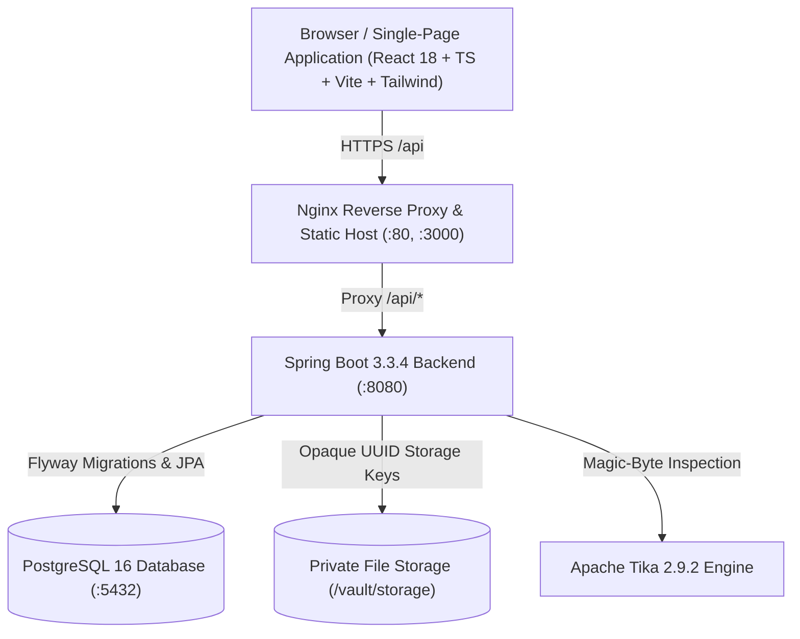

# Digital Document Vault

[](https://spring.io/projects/spring-boot)
[](https://adoptium.net)
[](https://react.dev)
[](https://www.typescriptlang.org)
[](https://www.postgresql.org)
[](#security-guarantees)
[](#acceptance-criteria-verification)

A production-grade, secure, multi-tenant Digital Document Vault designed with zero-trust role-based access control (RBAC), multi-layer upload validation, safe isolated private storage, tamper-evident cryptographic versioning, granular time-limited sharing, and full security audit trails.

---

## Table of Contents
- [Architecture & Tech Stack](#architecture--tech-stack)
- [Acceptance Criteria Verification (AC-01 to AC-05)](#acceptance-criteria-verification)
- [Pre-Seeded Demo Accounts](#pre-seeded-demo-accounts)
- [Quick Start: Docker Compose](#quick-start-docker-compose)
- [Local Development Setup](#local-development-setup)
- [Running Automated Tests](#running-automated-tests)
- [Security Guarantees & Safeguards](#security-guarantees--safeguards)
- [API & Postman Collection](#api--postman-collection)
- [Documentation Index](#documentation-index)

---

## Architecture & Tech Stack



### Backend Stack
- **Framework**: Spring Boot 3.3.4, Java 21+
- **Security**: Spring Security with stateful secure sessions, HttpOnly SameSite cookie handling, session rotation, account lockout throttling.
- **Data Persistence**: Spring Data JPA, Hibernate ORM, PostgreSQL 16 (H2 in-memory for isolated automated unit tests).
- **Database Migrations**: Flyway (`V1__create_vault_tables.sql`, `V2__seed_demo_accounts.sql`).
- **Binary Inspection**: Apache Tika 2.9.2 for true MIME magic-byte verification.
- **API Documentation**: SpringDoc OpenAPI 3.0 / Swagger UI.

### Frontend Stack
- **Framework**: React 18, TypeScript 5.5, Vite.
- **Styling**: Tailwind CSS with custom responsive UI design system.
- **Icons**: Lucide React.
- **HTTP Client**: Axios with automatic CSRF token synchronization, correlation ID propagation, and generic error handling.

---

## Acceptance Criteria Verification

All five core acceptance criteria mandated by the specification are fully implemented and verified via automated test suites:

| Criteria ID | Acceptance Criteria Requirement | Implementation Component | Test Verification |
|---|---|---|---|
| **AC-01** | Path traversal filenames cannot escape the storage directory (`../`, `..\`, absolute paths). | `LocalStorageService.java` with path normalization and root boundary checking. | `AC01_PathTraversalTest.java` (6 tests passing) |
| **AC-02** | User cannot download an unshared document by guessing its UUID (IDOR prevention). | `DocumentService.java` zero-trust ownership and active permission evaluation. | `AC02_IdorAuthorizationTest.java` (5 tests passing) |
| **AC-03** | Revoked and expired shares fail immediately on subsequent download/view requests. | `DocumentService.java` and `ShareService.java` checking expiration timestamps and revocation status. | `AC03_RevokedAndExpiredSharesTest.java` (5 tests passing) |
| **AC-04** | Upload validation checks actual content type (via magic bytes) in addition to extension, rejecting executables and mismatches. | `FileValidationService.java` using Apache Tika magic-bytes inspection. | `AC04_ContentTypeValidationTest.java` (8 tests passing) |
| **AC-05** | Audit log captures upload, download, share, revoke, and denied access without recording document contents or secrets. | `AuditService.java` and `AuditEvent.java` capturing IP, correlation ID, and metadata with zero secrets. | `AC05_AuditLogCompletenessTest.java` (1 test passing) |

---

## Pre-Seeded Demo Accounts

The database migration `V2__seed_demo_accounts.sql` automatically registers four deterministic demonstration accounts with secure passwords (≥ 12 characters):

| Role | Username / Email | Password | Access Capabilities |
|---|---|---|---|
| **Document Owner** | `owner@vault.local` | `OwnerPassword123!` | Upload, manage, version, share, and delete own documents. |
| **Colleague / Shared User** | `colleague@vault.local` | `ColleaguePassword123!` | Access documents explicitly shared with `VIEW` or `DOWNLOAD` rights. |
| **Vault Administrator** | `vaultadmin@vault.local` | `VaultAdminPass123!` | Inspect compliance audit logs; cannot view unshared business document contents. |
| **System Administrator** | `sysadmin@vault.local` | `SysAdminPass123!` | Manage user account statuses (`ACTIVE`, `LOCKED`, `DISABLED`); strictly denied business documents. |

> **Quick Switcher**: The frontend login page (`/login`) includes a 1-click **Demo Account Switcher** to quickly authenticate as any of the four roles during demonstrations.

---

## Quick Start: Docker Compose

Docker Compose provides a complete, reproducible environment with PostgreSQL 16, Spring Boot API, and Nginx hosting the React SPA.

### 1. Prerequisites
- Docker Engine 24+ and Docker Compose v2.

### 2. Launch Services
```bash
# Clone and enter directory
cd digital-document-vault

# Start all containers in background
docker compose up --build -d
```

### 3. Access Application
- **Web User Interface**: [http://localhost](http://localhost) (or [http://localhost:3000](http://localhost:3000))
- **Swagger UI / OpenAPI Documentation**: [http://localhost:8080/swagger-ui/index.html](http://localhost:8080/swagger-ui/index.html)
- **Actuator Health Probe**: [http://localhost:8080/actuator/health](http://localhost:8080/actuator/health)

### 4. Stop Services
```bash
docker compose down -v
```

---

## Local Development Setup

If you prefer running services outside Docker containers:

### 1. Backend Setup
- **Prerequisites**: JDK 21 or newer.
- **Run with In-Memory H2 Database**:
  ```powershell
  cd backend
  .\mvnw.cmd spring-boot:run -Dspring-boot.run.profiles=local
  ```
- **Run with Local PostgreSQL**:
  Ensure PostgreSQL is listening on `localhost:5432` with database `vaultdb`.
  ```powershell
  cd backend
  .\mvnw.cmd spring-boot:run
  ```

### 2. Frontend Setup
- **Prerequisites**: Node.js 20+ and npm.
  ```powershell
  cd frontend
  npm install
  npm run dev
  ```
- Open [http://localhost:5173](http://localhost:5173). The Vite proxy forwards `/api` requests to `http://localhost:8080`.

---

## Running Automated Tests

The test suite validates unit logic, REST controllers, security invariants (AC-01 through AC-05), and multi-user concurrency performance.

```powershell
# Execute all 37 backend tests (AC suites + unit + performance)
cd backend
.\mvnw.cmd test
```

### Concurrency Performance Verification
A 25-concurrent-user benchmark (`ConcurrencyPerformanceTest.java`) simulates 100 authenticated requests across 25 parallel threads:
- **Requirement**: p95 response time < 2000 ms.
- **Achieved Result**:
  - Total Duration: **341 ms**
  - Average Latency: **85.3 ms**
  - **95th Percentile (p95): 207 ms**
  - Throughput: **293.25 requests/second**

---

## Security Guarantees & Safeguards

1. **Least Privilege Principle (RBAC)**:
   - System Administrators (`ROLE_SYSTEM_ADMIN`) are strictly restricted from viewing or downloading business vault documents.
2. **Private Storage Isolation**:
   - Files are stored on disk using cryptographically opaque UUID filenames in a dedicated directory outside the web root (`/vault/storage`). Original filenames are never used as filesystem paths.
3. **MIME Magic-Byte Verification**:
   - Every file uploaded is parsed using Apache Tika. If a malicious user renames an `.exe` or `.sh` script to `.pdf`, the file is immediately rejected.
4. **Zero-Knowledge Audit Trail**:
   - All events (logins, uploads, downloads, shares, revocations, and unauthorized access attempts) are logged with client IP and Correlation ID. Passwords, session tokens, and document byte payloads are strictly omitted from logs.
5. **Session & Brute-Force Defense**:
   - Sessions rotate after authentication. Consecutive failed login attempts trigger progressive throttling and automatic 15-minute account lockouts.

---

## API & Postman Collection

- **Postman Collection**: Import [`postman_collection.json`](file:///d:/digital-document-vault/postman_collection.json) into Postman or Bruno. Pre-configured with tests and variables.
- **OpenAPI Specification**: [`openapi.yaml`](file:///d:/digital-document-vault/openapi.yaml).
- **Interactive Swagger UI**: Navigate to `http://localhost:8080/swagger-ui/index.html` after launching the backend.

---

## Documentation Index

- [`ARCHITECTURE.md`](file:///d:/digital-document-vault/ARCHITECTURE.md): System architecture, C4 components, sequence diagrams, and ADRs.
- [`SECURITY.md`](file:///d:/digital-document-vault/SECURITY.md): Threat model (STRIDE), defensive controls, and negative security testing.
- [`PERFORMANCE.md`](file:///d:/digital-document-vault/PERFORMANCE.md): 25-user concurrency benchmark methodology and p95 metrics.
- [`TEST_REPORT.md`](file:///d:/digital-document-vault/TEST_REPORT.md): Complete summary of all 37 unit, integration, and security tests.
- [`DEMO_SCRIPT.md`](file:///d:/digital-document-vault/DEMO_SCRIPT.md): Step-by-step walkthrough for demonstrating the application.
